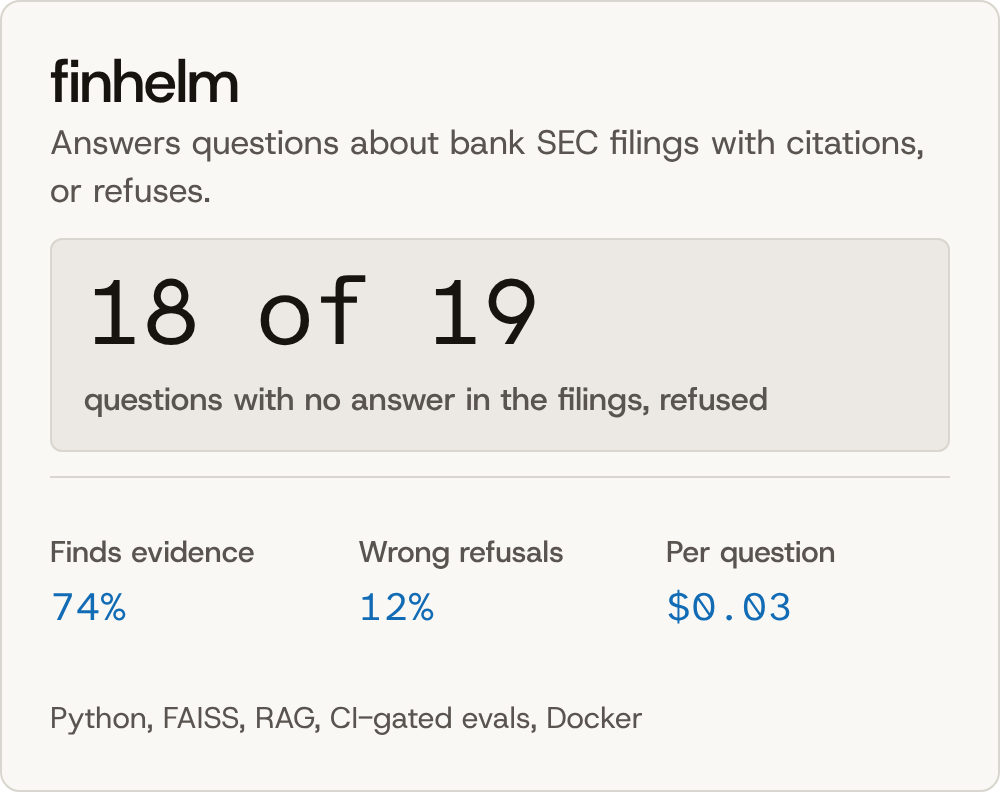

<h1 align="center">Om Hitesh Vyas</h1>

  

  I build data and ML systems, and say what the numbers can’t. 
  M.S. in Information Management, University of Illinois, 2026.

  <a href="https://www.linkedin.com/in/om-hitesh-vyas-97340a204/">LinkedIn</a>&nbsp;&nbsp;&nbsp;&nbsp;
  <a href="mailto:omvyas288@gmail.com">Email</a>&nbsp;&nbsp;&nbsp;&nbsp;
  <a href="https://huggingface.co/omvyas77">Hugging Face</a>&nbsp;&nbsp;&nbsp;&nbsp;
  <a href="https://public.tableau.com/app/profile/om.vyas">Tableau Public</a>

 

## Selected work

  <a href="https://github.com/omvyas77/finhelm"><picture><source media="(prefers-color-scheme: dark)" srcset="assets/finhelm-dark.png"></picture></a>
  <a href="https://github.com/omvyas77/uplift"><picture><source media="(prefers-color-scheme: dark)" srcset="assets/uplift-dark.png"></picture></a>

  <a href="https://github.com/omvyas77/program-health"><picture><source media="(prefers-color-scheme: dark)" srcset="assets/program-health-dark.png"></picture></a>
  <a href="https://github.com/omvyas77/Credit-risk-early-signals"><picture><source media="(prefers-color-scheme: dark)" srcset="assets/credit-risk-dark.png"></picture></a>

 

## Try them

| Project | Live | Read | Code |
| --- | --- | --- | --- |
| finhelm | [Demo on Hugging Face](https://huggingface.co/spaces/omvyas77/finhelm) | [Measuring refusal](https://github.com/omvyas77/finhelm/blob/main/blog/measuring-refusal.md) | [Repo](https://github.com/omvyas77/finhelm) |
| uplift | [Dashboard on Hugging Face](https://huggingface.co/spaces/omvyas77/uplift) | [Findings](https://github.com/omvyas77/uplift/blob/main/docs/findings.md) | [Repo](https://github.com/omvyas77/uplift) |
| program-health | [App on Hugging Face](https://huggingface.co/spaces/omvyas77/gies-program-health) [Dashboards on Tableau Public](https://public.tableau.com/app/profile/om.vyas/viz/GiesProgramHealth/Overview) | [Brief (PDF)](https://github.com/omvyas77/program-health/blob/main/brief/brief.pdf) | [Repo](https://github.com/omvyas77/program-health) |
| Credit-risk-early-signals | | [Report (PDF)](https://github.com/omvyas77/Credit-risk-early-signals/blob/main/cfpb_report.pdf) | [Repo](https://github.com/omvyas77/Credit-risk-early-signals) |

A demo that has been idle takes about a minute to wake.

 

## Research

- **[F-Transformer: a federated transformer for efficient and privacy-preserving sequence generation](https://doi.org/10.1038/s41598-026-40881-0)** *Scientific Reports* 16, 14093 (2026). [Code](https://github.com/omvyas77/Efficient-Sequence-Generator-)
- **BookNest: Ensemble-Based Book Recommendation System** Accepted at IC4S'05. [Code](https://github.com/omvyas77/BookNest-Ensemle-based-Book-Recommendation-System)

 

## Tools

**Data:** SQL, Python, PySpark, dbt, DuckDB, Postgres 
**Modeling:** scikit-learn, LightGBM, EconML, PyTorch, Hugging Face 
**Shipping:** FastAPI, Streamlit, Docker, GitHub Actions, Tableau

 

## Contact

Reach me on [LinkedIn](https://www.linkedin.com/in/om-hitesh-vyas-97340a204/) or at [omvyas288@gmail.com](mailto:omvyas288@gmail.com).
