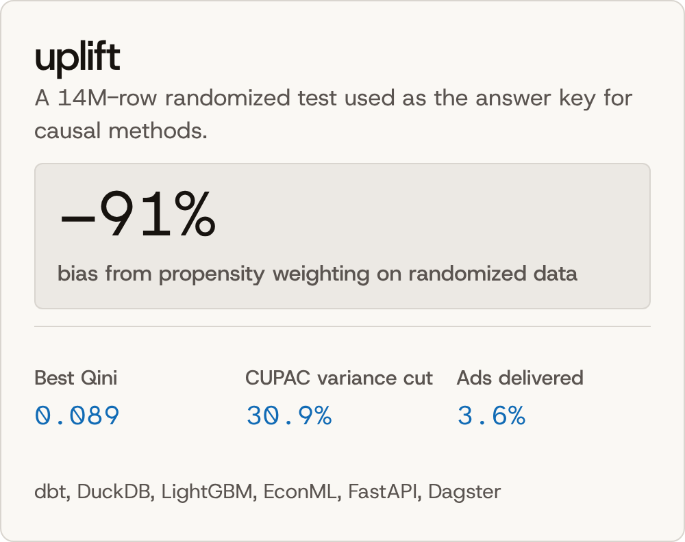
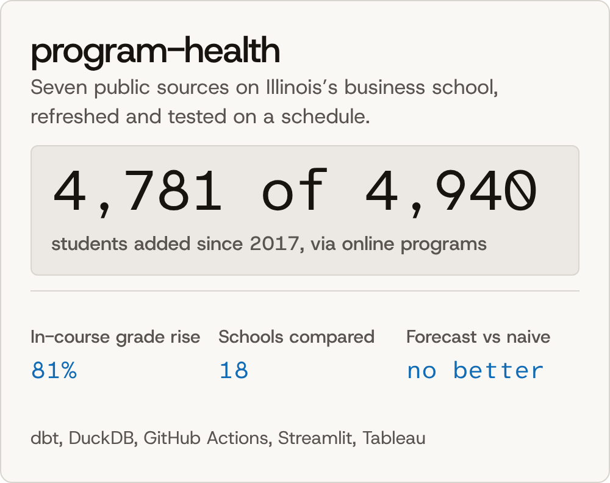
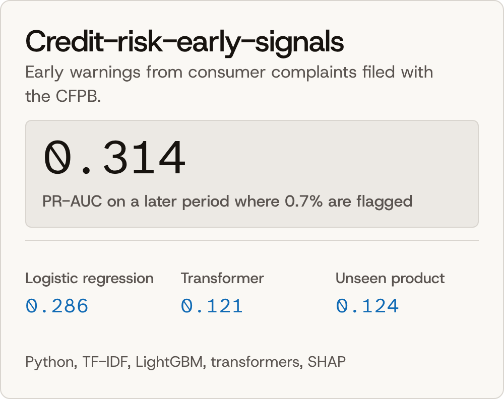

Om Hitesh Vyas

I build data and ML systems, and say what the numbers can’t. In uplift, a dashboard would have credited a campaign with 576,824 visits; a randomized test of 14M rows showed it caused about 92,000.

M.S. in Information Management, University of Illinois, 2026.

Selected work

 <a href="https://github.com/omvyas77/finhelm"><picture><source media="(prefers-color-scheme: dark)" srcset="finhelm-dark.png"></picture></a> <a href="https://github.com/omvyas77/uplift"><picture><source media="(prefers-color-scheme: dark)" srcset="uplift-dark.png"></picture></a> 
 
 <a href="https://github.com/omvyas77/program-health"><picture><source media="(prefers-color-scheme: dark)" srcset="program-health-dark.png"></picture></a> <a href="https://github.com/omvyas77/Credit-risk-early-signals"><picture><source media="(prefers-color-scheme: dark)" srcset="credit-risk-dark.png"></picture></a> 

You can try three of them: the finhelm demo, the uplift dashboard, and the program-health app, with its written brief. A demo that has been idle takes a minute to wake.

Research
F-Transformer: a federated transformer for efficient and privacy-preserving sequence generation. Scientific Reports 16, 14093 (2026). Paper and code.
BookNest: Ensemble-Based Book Recommendation System. IC4S'05. Code.
Tools

Data: SQL, Python, PySpark, dbt, DuckDB, Postgres  Modeling: scikit-learn, LightGBM, EconML, PyTorch, Hugging Face  Shipping: FastAPI, Streamlit, Docker, GitHub Actions, Tableau

Contact

Reach me on LinkedIn or at omvyas288@gmail.com. My demos are on Hugging Face and my dashboards on Tableau Public.
